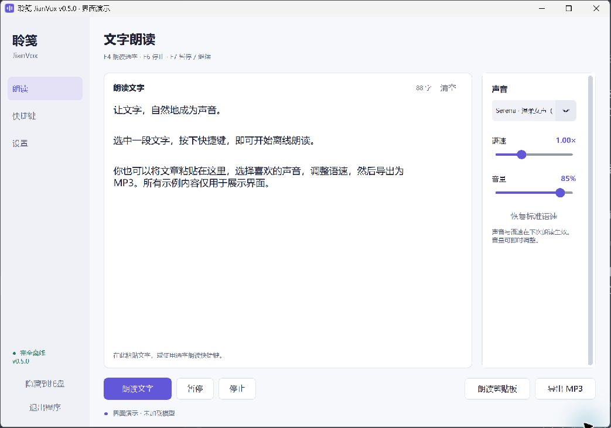

# 聆笺 JianVox · 离线 TTS 朗读与 MP3 导出

[](https://github.com/EllisMorrow/jianvox-offline-tts/releases/latest)
[](https://github.com/EllisMorrow/jianvox-offline-tts/actions/workflows/checks.yml)
[](LICENSE)

**当前版本：v0.5.0 · Windows x64 · 中文优先 · NVIDIA GPU · 本地运行**

Windows 中文离线朗读工具：选字后按快捷键，即可边生成边播放；也支持把长文本导出为 MP3。Jian 取“笺”的拼音，Vox 意为声音；名称不绑定某个模型。

基于 Qwen3-TTS 1.7B CustomVoice 和 faster-qwen3-tts。仓库只包含程序、图标、下载清单、测试与说明，模型和运行环境独立下载。不是 Qwen 官方客户端。

## 界面预览

以下为 v0.5.0 实际程序窗口的演示模式截图，使用公开示例文字，不展示个人设置，也未加载模型。日常使用时会显示真实的准备和朗读状态。



## 功能

界面使用左侧导航，分为“朗读”“快捷键”“设置”。状态提示固定在底部，播放工具栏保持可见；窗口初始大小会根据显示器工作区与 Windows 缩放调整。

- 自定义全局快捷键：默认 **F4 朗读、F6 停止、F7 暂停/继续**；每一项都可留空禁用。
- 朗读选字、剪贴板或窗口文字；支持九位内置声音与语气描述。
- 0.75–1.50 倍语速，使用流式 WSOLA 保持音调；语速和声音下次朗读生效，音量即时生效。
- 大文本分段生成 **MP3**，支持进度、剩余时间估算、自定义保存目录和取消。
- 开机自动启动开关；开启后下次登录只进入系统托盘，不弹出主窗口。默认关闭。
- 设置放在 Windows 用户设置目录，提供“打开设置文件夹”；程序目录被更新或删除后，偏好仍保留。
- 自带简洁的扁平图标，窗口、托盘与桌面快捷方式一致。

## 新电脑使用

1. 从 [Releases](https://github.com/EllisMorrow/jianvox-offline-tts/releases/latest) 下载 `JianVox-v0.5.0-windows-source.zip`，解压到长期保留、可写入的本地目录。
2. 连接适合下载大文件的网络，双击 **`开始下载.cmd`**。
3. 等待全部下载并校验完成，关闭下载器窗口，脚本会继续离线安装依赖、创建桌面快捷方式并启动助手。
4. 窗口显示“已就绪”后即可使用。

以后打开“聆笺 JianVox”桌面快捷方式或 **`启动朗读助手.cmd`**。这是自动配置型源码包，不是已内置模型的独立 EXE。运行时强制离线，不调用在线语音服务，不启动网络服务，不自动更新。

初次准备约下载 **8.05 GB**：模型约 4.52 GB，其余为 Python 和固定版本的运行依赖。建议预留 **25 GB** 磁盘空间。
下载器只使用魔搭国内仓库、南京大学/阿里云/华为云镜像，不回退海外原站；支持断点续传、SHA-256 校验、有限重试、连接/传输超时、速度、进度与剩余时间显示。

已有兼容 Python 时创建独立环境；没有时先准备 Python 3.12.10。不会改全局 PATH、默认 Python 或显卡驱动。

## 设备范围

面向 **Windows 10/11 x64 + 支持 BF16 的 NVIDIA 显卡**，建议 12 GB 显存、16 GB 以上内存。需要兼容 PyTorch CUDA 12.8 的 NVIDIA 驱动及 Microsoft Visual C++ x64 运行库。缺少系统组件时在大文件下载前提示，不静默安装驱动或系统运行库。

实测设备为 RTX 3060 12GB、32GB 内存。启动需加载和预热约半分钟；常驻约占 4.5 GB 显存。就绪后的一些文本测试约 1 秒开始声卡输出；速度会随文本、声音、语速及显卡负载变化。暂不提供 CPU、AMD 或 Mac 适配，也未在另一台全新电脑完成全流程验证。

## MP3 导出

1. 在“朗读”页粘贴文本，选择声音、语速和音量。
2. 点击“导出 MP3”，选择目录和文件名；也可在设置页提前指定常用目录。
3. 等待导出完成。第一段完成后会逐步估算剩余时间；点击“停止”可取消。

普通朗读最多 20000 字，导出最多 100 万字；按不超过 300 字的片段依次生成，保持音频缓冲有界。实际语音按当前语速和音量输出，文件没有写入原文、作者或文本派生的标题。
导出期间串行占用同一个模型，不会边播边导出或启动另一份模型；如需朗读其他文字，请先停止导出。暂停键用于朗读播放，导出任务使用停止取消。

不会覆盖已有文件。生成阶段使用系统自动删除的临时文件；成功后才保存到指定文件名。取消、常规失败或退出会清理临时音频。若系统在最后保存文件的瞬间崩溃，目标位置可能存在不完整的、原本就由用户指定保存的 MP3，需要自行检查。

## 隐私与设置

**程序自身不保存朗读历史、正文、生成缓存、运行日志、使用次数或时间统计。**

- 普通朗读只在内存中处理，不落地音频；窗口正文完成后自动清空，期间修改了正文则保留新输入，关闭程序后不恢复。
- 助手读取选字/剪贴板后会清空当次系统剪贴板；如果其他软件已捕获内容，助手不能删除它们的副本。
- 导出只保留用户明确保存的 MP3，临时编码文件自动删除。没有导出历史、最近文件列表或源文本副本。
- 声音、语气、快捷键、语速、音量和保存目录等必要偏好存于 **`%APPDATA%\QwenOfflineReader\settings.json`**；可以通过设置页打开文件夹。
  - 该目录名为兼容早期本地版本保留，品牌更名不会重置已有偏好。
- 开机启动仅管理当前用户注册表中本程序自己的启动项；删除程序前可先在设置页关闭它。
- 旧版已知的项目内日志和状态文件在新版启动时清理；不会扫描或删除用户自行保存的音频。

这里指的是应用自身不留使用记录，**不等于整台电脑的取证级“完全无痕”**。Windows 剪贴板历史/云同步、第三方剪贴板管理器、系统最近访问记录、备份、崩溃转储、分页文件及磁盘恢复等不受程序控制。普通文件删除也不等同于安全擦除。不要把应用的自动清理理解为系统级隐私保证。

## 使用限制

自动选字朗读通过复制快捷键读取新文字，要求文字可复制；图片和扫描件需先识别。复制失败时不会误读旧剪贴板。目标软件以管理员权限运行时，Windows 可能限制自动复制。

分段切换可能有停顿；高倍速或显卡同时运行其他任务时可能等待后续声音。模型也可能读错数字、多音字、专有名词或英文，重要内容请核对。切换 Windows 音频输出设备后请退出重开。

## 发布内容与本地目录

| 路径 | 用途 | 进入发布包 |
| --- | --- | --- |
| `app/`、`assets/` | 程序与图标；界面构建、任务协调、推理播放分别组织 | 是 |
| `scripts/` | 下载/安装脚本、版本和校验清单 | 是 |
| `tests/`、`docs/`、说明及许可 | 开发验证与文档 | 是 |
| `.downloads/` | 模型及安装包 | 否 |
| `.python/`、`.runtime/` | 机器上的运行环境 | 否 |
| `.local/` | 本机安装位置配置 | 否 |
| Windows 用户设置目录 | 个人偏好 | 否 |
| `dist/` | 本地构建的源码 ZIP | 否 |

打包脚本只按允许的目录和文件类型收集发布文件，并检查越界路径、二进制类型和敏感路径/凭证模式。模型、环境、个人设置、生成音频、日志、安装报告及缓存均不进入源码包。

移动已安装的虚拟环境不保证可用。迁移到另一设备应重新执行准备脚本。高级用户可通过本机 `.local/install.json` 的 `runtime_python`、`model_path`、`downloads_path` 指向已有文件；这些本机绝对路径不应上传。

本项目没有自动建仓库、上传、推送或发布的功能。下载脚本只接收公开依赖，不会回传用户数据。

## 开发与验证

使用 Python 3.12 与现有运行环境：

```powershell
$env:PYTHONPATH = "$PWD\app"
python -B -m unittest discover -s tests -v
python -B tests/smoke_ui.py
python -B tests/smoke_ui.py --hidden
python -B tests/check_layout.py
powershell -NoProfile -ExecutionPolicy Bypass -File scripts/bootstrap.ps1 -CheckOnly
python -B scripts/build_release.py
```

可选 `tests/verify_export.py` 需真实 GPU，测试文件使用临时目录并自动删除。默认测试不会写入朗读历史。其他历史基准脚本仅用于开发，若主动运行并产生报告，应自行管理其输出，不能把开发脚本当成日常隐私模式。

实际验证边界见 [docs/VALIDATION.md](docs/VALIDATION.md)。许可证与依赖说明见 [THIRD_PARTY.md](THIRD_PARTY.md)。自行编写代码和图标采用 MIT 许可，第三方组件保留其各自许可。

代码、运行环境、模型、个人设置与发布物的边界见 [docs/STRUCTURE.md](docs/STRUCTURE.md)。

## English overview

JianVox is a local-first Windows text-to-speech reader, focused on Chinese with English support. Select copyable text and press a configurable hotkey, or paste an article and export an MP3. It supports streaming playback, pitch-preserving speed control, pause/resume, tray startup, and user-scoped preferences.

The current backend is Qwen3-TTS 1.7B CustomVoice with faster-qwen3-tts. The project name is model-independent. Model weights and the private Python runtime are downloaded separately; they are not included in this repository or the release ZIP. Windows x64 and a supported NVIDIA GPU are required. The full installation path has not yet been validated on a second clean machine.

## 反馈

欢迎提交 [Issue](https://github.com/EllisMorrow/jianvox-offline-tts/issues)。请只提供必要的系统版本、显卡型号、复现步骤和经过脱敏的错误信息；不要上传个人正文、音频、设置文件或本机安装配置。
