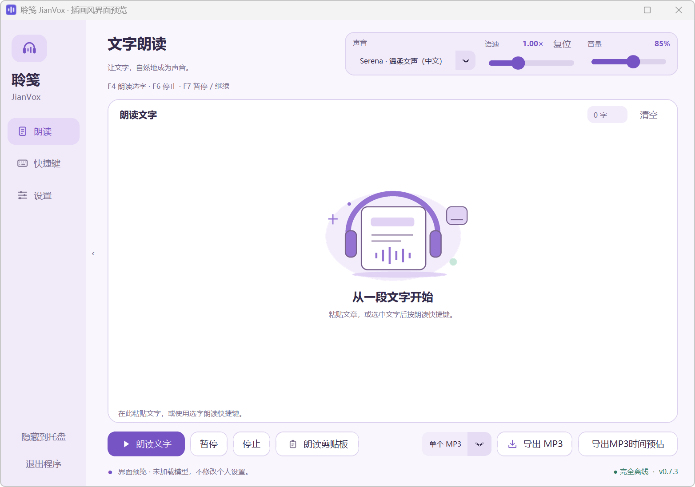
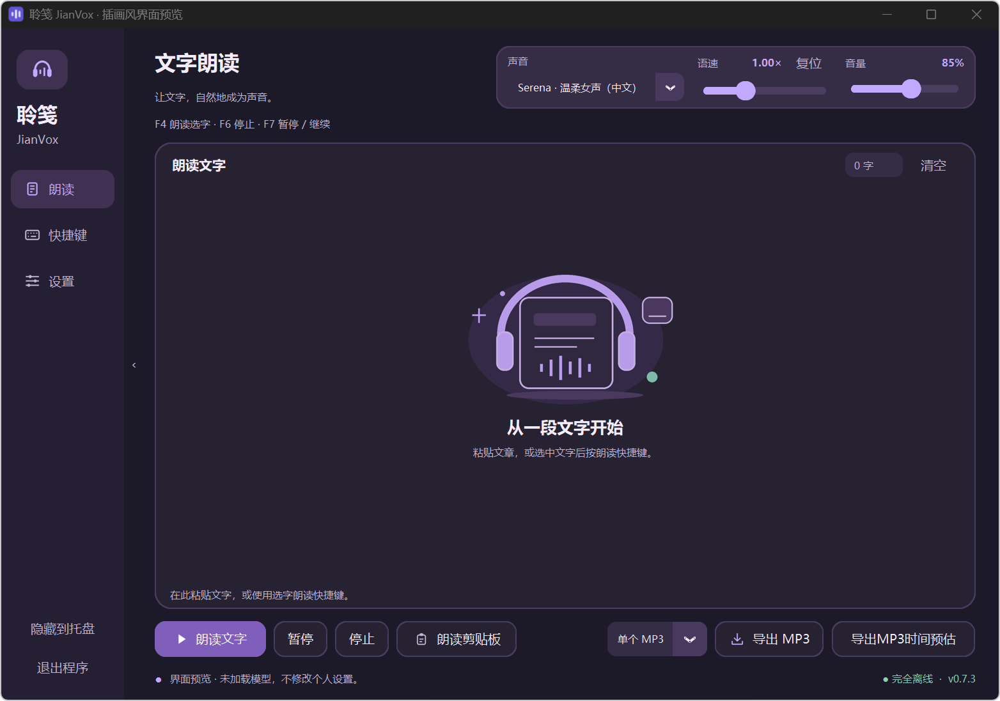

# 聆笺 JianVox · 离线朗读与 MP3 导出

[](https://github.com/EllisMorrow/jianvox-offline-tts/releases/latest)
[](https://github.com/EllisMorrow/jianvox-offline-tts/releases)
[](https://github.com/EllisMorrow/jianvox-offline-tts/actions/workflows/checks.yml)
[](LICENSE)

**选中文字，按 F4 听朗读；粘贴长文，导出 MP3。首次联网准备，日常离线使用。**


面向 Windows 的中文优先朗读工具，支持九位内置声音、语气描述、暂停、变速与音量增强。基于 Qwen3-TTS 1.7B CustomVoice 和 faster-qwen3-tts，不是 Qwen 官方客户端。

> 当前版本：**v0.7.3**。首次使用请从 [Releases 发布页](https://github.com/EllisMorrow/jianvox-offline-tts/releases/latest) 下载下文指定的源码包，并按步骤自动准备环境。

## 先确认电脑是否适用

| 项目 | 要求 / 建议 |
| --- | --- |
| 系统 | Windows 10 / 11，64 位（x64） |
| 显卡 | 支持 BF16 的 NVIDIA 显卡，需兼容 CUDA 12.8 的驱动 |
| 显存建议 | **8 GB 或以上**（根据本机占用预留余量的估算建议）；**12 GB 是已验证配置，并非最低门槛** |
| 显存占用参考 | 本机模型加载完成时约 **4.6 GiB** 专用显存；最近采样约 4.64 GiB，不是全过程峰值 |
| 内存 / 磁盘 | 建议 **16 GB 以上内存**，预留 **25 GB** 可用磁盘空间 |
| 首次准备 | 约下载 **8.05 GB**，其中模型约 4.52 GB；需要联网 |
| Python | 运行需要 **64 位 Python 3.12**；**不用提前手动安装**，首次脚本会自动准备独立环境 |

实测设备：RTX 3060 12GB、32GB 内存。暂不支持 CPU、AMD 显卡或 Mac。尚未在另一台全新电脑完成全流程验证。

显存参考值只统计本程序模型进程，不是整张显卡的总占用。还需给系统、其他程序和生成过程留出余量；**6 GB、8 GB 显卡尚未实测，最低显存要求尚未确定**。8 GB 建议不代表已完成兼容性验收。

首次准备入口使用 Windows 自带的 PowerShell，电脑没有安装 Python 也能启动这套自动准备流程。

## 第一次安装：下载 → 解压 → 准备 → 朗读

1. 打开 [Releases 发布页](https://github.com/EllisMorrow/jianvox-offline-tts/releases/latest)，在 **Assets（发布附件）** 中下载 **`JianVox-v<版本>-windows-source.zip`**。不要用仓库绿色 **Code → Download ZIP** 或自动生成的 `Source code` 附件代替。
2. 右键 ZIP，选择“全部解压”，放到长期保留、可写入的目录，例如 `D:\JianVox`。**完整解压后再操作，不要在 ZIP 窗口中直接运行。** 没有 D 盘可选用户目录下的专用文件夹。
3. 连接网络，在解压出的文件夹双击 **`开始下载.cmd`**。脚本先检查必要组件并准备 Python：已装兼容的 64 位 Python 3.12 时，用它创建独立运行环境；没有时，先自动下载约 26 MB 的 Python 3.12.10 安装器，安装到程序目录，再创建独立环境。完成后才会打开模型与依赖下载器。首次只看到脚本窗口时，请等候或查看提示，无需手工安装 Python。
4. 等下载器显示 **“全部下载完成，并通过完整性校验”**：确认完成提示，然后**关闭下载器窗口**。保留后方脚本窗口，让它继续校验、离线安装、创建桌面快捷方式并自动打开助手。
5. 首次打开需加载和预热模型，实测约半分钟；等窗口显示 **“已就绪”** 后开始使用。

**以后只打开桌面的“聆笺 JianVox”快捷方式，或双击 `启动朗读助手.cmd`。不必重复下载。** 程序文件夹需保留，快捷方式依赖其中的文件。

下载中断、暂停或关闭后，重新打开**原文件夹**的 `开始下载.cmd` 即可复用已完成文件和断点；下载器内也可点“继续下载 / 重试”。未完成下载时关闭窗口不会进入安装。遇到驱动、VC++ 或磁盘提示，按 [新手指南与常见问题](docs/QUICKSTART.md) 处理。

这是自动配置型源码包，不是内置模型的独立 EXE。运行时强制离线，不调用在线语音服务、不启动网络服务、不自动更新。

## 日常使用

| 想做什么 | 操作 |
| --- | --- |
| 朗读其他软件里的文字 | 选中可复制的文字，按 **F4** |
| 朗读自己的文章 | 把文字粘贴到“朗读”页正文框，再点“朗读文字” |
| 朗读已复制的内容 | 点击“朗读剪贴板” |
| 暂停 / 继续，停止 | **F7** 暂停 / 继续；**F6** 停止 |
| 保存为 MP3 | 粘贴正文，设好声音、语速、音量，选导出方式，再点“导出 MP3” |
| 修改快捷键 | 打开“快捷键”页，修改后保存；留空可禁用单项 |

默认点击窗口 **×** 后进入系统托盘，朗读和快捷键继续运行；在“设置”关闭 **“点击关闭按钮后进入系统托盘”**，× 就会真正退出。需要立即退出时，也可点击侧栏“退出程序”或使用托盘退出。开机启动默认关闭，可在设置中开启，下次登录只进入托盘。

状态栏会提示本次取字来源：**剪贴板（主通道）**、复制失败时的**直接取字（备用）**（Windows UI Automation），或从正文框朗读的**窗口文字**。直接取字要求目标软件支持读取选区，无法保证所有程序可用，也不能识别图片或扫描件。读取失败时可自行复制后点“朗读剪贴板”，或粘贴到正文框。

声音和语速在下次朗读生效，音量即时生效。正文会保留到手动清空或真正退出，隐藏到托盘不会清空；**下次启动不会恢复正文**。必要偏好自动保存到用户设置目录。

## 界面预览

以下为新版插画风界面的白天 / 夜晚预览截图（预览模式未加载语音模型）。在“设置”中可切换白天、夜晚或跟随系统主题。

**白天主题**



<details>
<summary>查看夜晚主题</summary>



</details>

## 更多说明

第一次使用、安装故障与更新注意事项见 **[新手指南](docs/QUICKSTART.md)**。导出规则、隐私边界和运行限制见下列说明。

<details>
<summary>MP3 导出、音量增强与长文说明</summary>

语速范围为 **0.75–1.50 倍**，通过流式 WSOLA 保持音调。音量为 **0–150%**：100% 为原始音量，150% 最高约 +9 dB（较小声音振幅约 2.82 倍），并对接近满幅的高峰柔和限幅。增强不保证完全无失真，声音原本较大时可调低。朗读与导出的后续片段使用当前音量，已经生成的片段不会重写；整份音量一致请在导出前设定。

1. 在“朗读”页粘贴文本，选择声音、语速和音量。
2. 可先点击“导出MP3时间预估”。首次会在本机生成一小段样本，不播放、不保存；给出导出用时、音频时长和磁盘空间的参考范围。同一声音、语气和相近语言的后续预估复用内存中的测量，程序退出即清除。
3. 选择“单个 MP3”或“分章 MP3”，再点击“导出 MP3”，选择目录和文件名；也可在设置页提前指定常用目录。悬浮按钮可查看字数上限和保存方式。
4. 等待导出完成。第一段完成后会逐步估算剩余时间；点击“停止”可取消。

普通朗读最多 20000 字，导出最多 100 万字；按不超过 300 字的片段依次生成，保持音频缓冲有界。语速在开始时确定，音量可对后续输出即时调整；文件没有写入原文、作者或文本派生的标题。
单文件模式全部成功后才保存，取消或失败需重做。分章模式按约 3000 字及合成片段边界分组，生成 `自选文件名_001.mp3`、`_002.mp3` 等独立文件；不会自动识别原文章节。已完成文件属于用户明确保存的音频，后续失败或取消只清理当前章临时音频。没有自动续作或正文/断点清单，若需继续，请自行粘贴剩余内容并选择新的文件名前缀。任何同名目标都会拒绝覆盖。
导出期间串行占用同一个模型，不会边播边导出或启动另一份模型；如需朗读其他文字，请先停止导出。暂停键用于朗读播放，导出任务使用停止取消。

预估需要先停止正在进行的朗读或导出，首次短样本本身也需要几秒至数十秒。参考范围不包含模型启动或探测时间；语速只改变音频时长和后处理开销，不会按倍数加快模型生成。正文类型、数字、停顿、显卡负载及长期运行会影响误差；百万字上限代表输入容量，并不代表已完成百万字全程实测。建议长篇先用一章确认发音和效果，再分章节导出。

不会覆盖已有文件。生成阶段使用系统自动删除的临时文件；成功后才保存到指定文件名。取消、常规失败或退出会清理临时音频。若系统在最后保存文件的瞬间崩溃，目标位置可能存在不完整的、原本就由用户指定保存的 MP3，需要自行检查。

</details>

<details>
<summary>隐私与设置：会保存什么</summary>

**程序自身不保存朗读历史、正文、生成缓存、运行日志、使用次数或时间统计。**

- 普通朗读只在内存中处理，不落地音频；窗口正文在任务完成后继续保留，只有用户手动清空或真正退出程序时清除，下次启动不恢复。关闭窗口若按设置隐藏到托盘，仍属于运行中，会保留窗口正文；关闭托盘选项后，点击 × 会真正退出并清空正文。
- 通过剪贴板取得文字时，助手在朗读任务接受后才清空当次内容；尚未就绪、超限或提交失败时保留，后来复制的新内容不会被清空。直接取字通道不读取、改写或清理剪贴板。如果其他软件已捕获内容，助手不能删除它们的副本。
- 导出只保留用户明确保存的 MP3，临时编码文件自动删除。没有导出历史、最近文件列表或源文本副本。
- 主题、声音、语气、快捷键、语速、音量、导出方式和保存目录等必要偏好存于 **`%APPDATA%\QwenOfflineReader\settings.json`**；可以通过设置页打开文件夹。
  - 该目录名为兼容早期本地版本保留，品牌更名不会重置已有偏好。
- 开机启动仅管理当前用户注册表中本程序自己的启动项；删除程序前可先在设置页关闭它。
- 旧版已知的项目内日志和状态文件在新版启动时清理；不会扫描或删除用户自行保存的音频。

这里指的是应用自身不留使用记录，**不等于整台电脑的取证级“完全无痕”**。Windows 剪贴板历史/云同步、第三方剪贴板管理器、系统最近访问记录、备份、崩溃转储、分页文件及磁盘恢复等不受程序控制。普通文件删除也不等同于安全擦除。不要把应用的自动清理理解为系统级隐私保证。

</details>

<details>
<summary>快捷键、取字与运行限制</summary>

快捷键默认使用 Windows 普通注册方式。遇到占用时，可在“快捷键”页勾选 **“优先接管已占用快捷键”**，再点击“保存快捷键”。开启后，本程序优先处理设定的组合，其他程序暂时收不到这些组合；未设置的按键正常通过。留空可停用单个操作，退出程序会解除接管。

窗口隐藏时，快捷键朗读、停止、暂停均不唤出主界面；复制失败或模型尚未就绪也只更新状态，不抢占当前窗口。需要查看状态或调整设置时，可通过托盘或桌面快捷方式主动打开主界面。

关闭优先接管时若仍有注册冲突，会提示并恢复原模式；可先换键、清空对应设置或解除其他软件占用后再保存。系统保留操作、安全桌面、权限差异以及其他键盘拦截工具不保证可覆盖；本程序不自动提权，也不关闭或修改其他软件。接管回调只匹配按键并投递操作，不运行模型或读写文件，不保存按键历史。

自动选字朗读优先通过复制快捷键读取新文字；复制失败时尝试 UI Automation 直接读取选区。两种方式都要求目标软件提供对应能力；图片和扫描件需先识别，不会把旧剪贴板误作本次选区。目标软件以管理员权限运行时，Windows 可能限制读取。

选字复制前默认缓冲约 300 毫秒，等待修饰键释放，并为源程序生成剪贴板文本预留时间。确认复制没有新结果后会立即尝试直接取字；取字期间切换窗口或停止朗读会取消本次读取。普通窗口输入、手动朗读剪贴板和 MP3 导出不增加这段缓冲。此处理改善时序容错，不保证受保护或不支持复制的内容可读取。

分段切换可能有停顿；高倍速或显卡同时运行其他任务时可能等待后续声音。模型也可能读错数字、多音字、专有名词或英文，同一声音的声线也可能漂移，重要内容请核对。没有为本次可靠性改进改变模型采样参数或固定混读语言。

默认音频设备变化或失效后会有限重连；设备断开超过约 15 秒会停止本次播放并清空缓冲，重新连接后可再次朗读。没有播放设备也可预估或导出 MP3。操作系统或音频驱动完全无响应时仍可能需要重开程序或重启电脑。

模型只在一个受监督的本地子进程中运行，正文与音频经本机进程通信传递，不启动网络服务、不写日志。启动等待上限 180 秒，单块生成无响应上限 30 秒；取消时最多等待约 2 秒正常收尾，仍无响应则结束模型进程。故障后仅自动重新加载一次，不重放失败文本；若准备仍失败，可在设置页点击“重新加载声音”。重新加载需重新预热，不保证故障后即时恢复，也无法修复驱动或硬件故障。

设置页提供“复制诊断摘要”：仅包含程序/Python 版本、平台、模型就绪状态和最近错误类别，不含原文、路径、语气、音频或完整异常信息。诊断不自动保存，复制由用户主动触发；程序退出即清除内存中的错误类别。

</details>

<details>
<summary>安装机制、发布内容与本地目录</summary>

下载器只使用魔搭国内仓库、南京大学/阿里云/华为云镜像，不回退海外原站；支持断点续传、SHA-256 校验、有限重试、连接/传输超时、速度、进度与剩余时间显示。有兼容 Python 时复用它来创建独立环境；没有时准备 Python 3.12.10，不改全局 PATH、默认 Python 或显卡驱动。

需要兼容 PyTorch CUDA 12.8 的 NVIDIA 驱动及 Microsoft Visual C++ x64 运行库；缺少驱动入口或运行库时会在大文件下载前提示，不静默安装这些系统组件。本机已加载模型时专用显存参考约 4.6 GiB，未测全过程峰值；就绪后的部分文本约 1 秒开始输出，实际速度随文本、声音、语速及显卡负载变化。

| 路径 | 用途 | 进入发布包 |
| --- | --- | --- |
| `app/`、`assets/` | 程序与图标；界面构建、任务协调、推理播放分别组织 | 是 |
| `scripts/` | 下载/安装脚本、版本和校验清单 | 是 |
| `tests/`、`docs/`、说明及许可 | 开发验证与文档 | 是 |
| `.downloads/` | 模型及安装包 | 否 |
| `.python/`、`.runtime/`、`runtime/` | 机器上的运行环境，含复用的完整 Python 安装 | 否 |
| `.local/` | 本机安装位置配置 | 否 |
| Windows 用户设置目录 | 个人偏好 | 否 |
| `dist/` | 本地构建的源码 ZIP | 否 |

打包脚本只按允许的目录和文件类型收集发布文件，并检查越界路径、二进制类型和敏感路径/凭证模式。模型、环境、个人设置、生成音频、日志、安装报告及缓存均不进入源码包。

高级用户可通过本机 `.local/install.json` 的 `runtime_python`、`model_path`、`downloads_path` 复用已有文件。程序根目录内使用相对路径，外部目录也兼容绝对路径；配置不依赖启动时的工作目录，且不进入发布包。

已安装的 Python 或虚拟环境并非任意移动后都保证可用：其控制台入口、注册信息和快捷方式可能需要修正。整合本机目录应先验证已有文件、更新引用并做实际运行检查，不能仅修改配置就视为迁移完成。迁移到另一设备仍应执行准备脚本。

本项目没有自动建仓库、上传、推送或发布的功能。下载脚本只接收公开依赖，不会回传用户数据。

</details>

<details>
<summary>开发、验证与许可</summary>

使用 Python 3.12 与现有运行环境：

```powershell
$env:PYTHONPATH = "$PWD\app"
python -B -m unittest discover -s tests -v
python -B tests/smoke_ui.py
python -B tests/smoke_ui.py --hidden
python -B tests/check_layout.py
powershell -NoProfile -ExecutionPolicy Bypass -File scripts/bootstrap.ps1 -CheckOnly
python -B scripts/build_release.py
```

可选 `tests/verify_export.py` 需真实 GPU，测试文件使用临时目录并自动删除。默认测试不会写入朗读历史。其他历史基准脚本仅用于开发，若主动运行并产生报告，应自行管理其输出，不能把开发脚本当成日常隐私模式。

实际验证边界见 [docs/VALIDATION.md](docs/VALIDATION.md)。许可证与依赖说明见 [THIRD_PARTY.md](THIRD_PARTY.md)。自行编写代码和图标采用 MIT 许可，第三方组件保留其各自许可。

代码、运行环境、模型、个人设置与发布物的边界见 [docs/STRUCTURE.md](docs/STRUCTURE.md)。

</details>

## English overview

JianVox is a local-first Windows text-to-speech reader, focused on Chinese with English support. Select copyable text and press a configurable hotkey, or paste an article and export an MP3. It supports streaming playback, pitch-preserving speed control, pause/resume, tray startup, and user-scoped preferences.

The current backend is Qwen3-TTS 1.7B CustomVoice with faster-qwen3-tts. The project name is model-independent. Model weights and the private Python runtime are downloaded separately; they are not included in this repository or the release ZIP. Windows x64 and a supported NVIDIA GPU are required. The full installation path has not yet been validated on a second clean machine.

## 反馈

欢迎提交 [Issue](https://github.com/EllisMorrow/jianvox-offline-tts/issues)。请只提供必要的系统版本、显卡型号、复现步骤和经过脱敏的错误信息；不要上传个人正文、音频、设置文件或本机安装配置。
